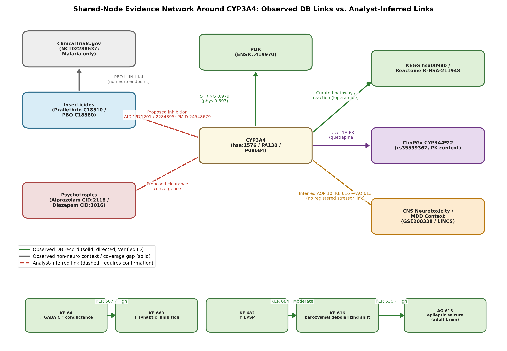

# Evidence-Bounded Assessment of a Candidate Insecticide-Benzodiazepine Combination

**Final report | 24 November 2026**

## 1. Databases used and extracted information

| Database / source | Question addressed | Locally retained IDs and scope | Check date and boundary |
|---|---|---|---|
| PubChem BioAssay | What prallethrin assay records target CYP enzymes? | CID 9839306; AIDs 1671197, 2284395, 1671201, 2283680, 2283689, 2283698, 2284096; CYP2C19 GeneID 1557 and CYP3A4 GeneID 1576 | Locators reviewed 2026-11-23; assay species recorded as Unknown |
| CTD / PubMed | What chemical-gene metabolism and neurotoxicity-gene entries are retained? | Permethrin D026023; CYP2C19 1557 and CYP3A4 1576; PMID 24548679; 33 neurotoxicity-gene rows with Gene IDs, PMIDs and URLs | Locators reviewed 2026-11-23; CTD original query/date not retained |
| STRING v12.5 | What CYP3A4-POR association is recorded? | CYP3A4 9606.ENSP00000498939; POR 9606.ENSP00000419970; combined 0.979, physical 0.597 | Checked 2026-11-06; functional association does not establish physical binding |
| KEGG / Reactome r98 | What CYP3A4 pathway and reaction context is retained? | hsa:1576 / hsa00980; R-HSA-211948; ingredient IDs C18510 (prallethrin), C18880 (PBO) | Checked 2026-11-06; ingredient pathway/reaction gaps are coverage gaps |
| ClinPGx / gnomAD v4 | What CYP3A4 pharmacogenomic context is recorded? | PA130; rs35599367 / CYP3A4*22; Level 1A quetiapine pharmacokinetic annotation; AF 3.172% overall and 0.000% East Asian | Checked 2026-11-06; population frequency is not personal risk |
| ClinicalTrials.gov | What is the scope of the retained PBO trial search? | 12 PBO-intervention study records: 11 malaria and 1 lice; example NCT02288637, malaria endpoints, n=3,840 | Checked 2026-11-06; no psychiatric/neurotoxicity endpoint in this local search scope; example has no results posted |
| INCB Green List, 36th edition | Are nominated psychotropics listed as controlled substances? | Alprazolam PA 004 / CID 2118 and diazepam PD 006 / CID 3016; Schedule IV | Official 2025 list checked 2026-11-23 |
| AOP-Wiki | What observed relationships form the seizure-pathway context? | AOP 10; KER 667, 684, 630; KE 64, 669, 682, 616; AO 613 | Checked 2026-11-22/23; nominated chemicals are not registered AOP 10 stressors |
| GEO / LINCS / cBioPortal TCGA-LIHC | What local MDD, perturbation, and tumor-context artifacts exist? | GSE208338 / GPL5188 / PMID 40253403; LINCSCP_22231; `lihc_tcga_pan_can_atlas_2018` | Source scope is retained; see Section 4 for analysis limitations |

**Table 1.** Source inventory and extracted scope. Provenance boundary: [`data/SOURCE_PROVENANCE.md`](../data/SOURCE_PROVENANCE.md) and [`experiment/evidence_table.csv`](../experiment/evidence_table.csv).

The records come from distinct contexts and do not independently establish one shared mechanism. No human assay species is assigned where the local assay record says Unknown.

## 2. Cross-database integration method

**Figure 1.** Solid edges show recorded database relationships or context; dashed edges show analyst-inferred hypotheses. The directed AOP 10 KER sequence is observed pathway context, not a chemical-to-AOP connection. Generated by [`experiment/make_network_audit.py`](../experiment/make_network_audit.py) from [`experiment/evidence_table.csv`](../experiment/evidence_table.csv).

| Join key | Linked records | Boundary |
|---|---|---|
| NCBI GeneID | Prallethrin assay and CTD Permethrin metabolism rows are associated through GeneIDs 1557 (CYP2C19) and 1576 (CYP3A4) | Cross-dataset association; does not show prallethrin changes permethrin metabolism |
| STRING protein IDs | CYP3A4 `9606.ENSP00000498939` and POR `9606.ENSP00000419970` | Functional score 0.979; physical score 0.597, below the 0.700 cutoff |
| KEGG / Reactome IDs | CYP3A4 `hsa:1576` in hsa00980; catalyst in R-HSA-211948 | Example map/reaction concerns other substrates; no curated prallethrin/PBO link in the retained audit |
| AOP event IDs | KER 667: KE 64→669; KER 684: KE 682→616; KER 630: KE 616→AO 613 | Observed AOP relationships; no nominated chemical is a registered AOP 10 stressor |

**Table 2.** Identifier joins and their interpretation limits. Species and conditions follow the source rows; unknown assay species remain unknown.

## 3. Candidate combination and shared-node interaction screen

| Candidate pair | Observed shared nodes | Inferred shared nodes | Evidence-table basis and interpretation |
|---|---:|---:|---|
| Prallethrin + alprazolam | **0 (evidence gap)** | 1: CYP3A4 / NCBI 1576 | INFERRED_01 + INFERRED_02; cross-dataset / PK hypothesis only |
| Prallethrin + diazepam | **0 (evidence gap)** | 1: CYP3A4 / NCBI 1576 | INFERRED_01 + INFERRED_02; diazepam-specific metabolism link is not independently documented in these rows |
| Permethrin + alprazolam | **0 (evidence gap)** | 1: CYP3A4 / NCBI 1576 | INFERRED_01 + INFERRED_02; CTD source statement and PK context do not establish a mixture effect |
| Permethrin + diazepam | **0 (evidence gap)** | 1: CYP3A4 / NCBI 1576 | INFERRED_01 + INFERRED_02; diazepam-specific link is not independently documented |
| PBO + alprazolam | **0 (evidence gap)** | 1: CYP3A4 / NCBI 1576 | INFERRED_01 + INFERRED_02 include PBO in an aggregate hypothesis row; no direct PBO-to-CYP3A4 link is recorded there |
| PBO + diazepam | **0 (evidence gap)** | 1: CYP3A4 / NCBI 1576 | Aggregate hypothesis only; no direct PBO or diazepam-to-CYP3A4 pair evidence |

**Table 3.** Candidate-pair shared-node counts, separated by observed versus inferred evidence. The course screening rule is that a pair connected to more common nodes is considered more likely to interact. Counts are calculated from source/link classes in `experiment/evidence_table.csv`: observed links to CYP3A4 for the candidate ingredient-psychotropic pairs are absent, while the inferred node derives from hypothesis rows INFERRED_01 and INFERRED_02. These rows aggregate chemicals, so the inferred count is a hypothesis-screen value rather than independent compound-specific confirmation.

The CYP3A4 overlap identifies a follow-up hypothesis, but the candidate pairs tie on the inferred screen and have zero observed shared nodes, so the retained records do not support ranking one pair above another. The databases do not contain mixture response data; Bliss independence, additive, synergistic, and antagonistic classifications cannot be determined.

## 4. External evidence, bonus analyses, and process audit

### 4.1 Bonus 1 — Psychiatric disease association

| Evidence item | Local observation | Completion status / limit |
|---|---|---|
| GEO GSE208338 | Series metadata identifies postmortem human DLPFC; MDD n=24, controls n=62; GPL5188; PMID 40253403 | Metadata scope only; local candidate-panel statistics lack the original expression matrix and analysis script |
| MDD DEG file | `GSE208338_MDD_vs_Control_DEGs_log2FC_gt1_FDR_lt0.05.csv` has **0 data rows** | **Not performed / No quantifiable DEG overlap (0 data rows in repository)**; no overlap number is inferred |
| LINCS `LINCSCP_22231` | Local HepG2 haloperidol signature, 10 µM / 6 h; 9 positive and 5 negative values in the local signature table | Single-agent liver-cell context; not evidence of a psychiatric disease association or brain effect |
| CTD neurotoxicity/disease-gene table | 33 retained gene rows for MeSH `MESH:D020258` (Neurotoxicity Syndromes), with Gene IDs and PMIDs | Neurotoxicity gene context; no quantifiable overlap with the empty MDD DEG file |
| ClinicalTrials.gov PBO scope | 12 local search results: 11 malaria and 1 lice; **0 psychiatric or neurotoxicity endpoints** in this result set | Search-scope finding only; NCT02288637 studies malaria endpoints and has no posted results |

**Table 4.** Psychiatric-disease association evidence and explicit completion status. Source fields and limitations are catalogued in [`data/SOURCE_PROVENANCE.md`](../data/SOURCE_PROVENANCE.md), [`experiment/clinpgx_clinicaltrials_evidence.txt`](../experiment/clinpgx_clinicaltrials_evidence.txt), and the local CTD table.

**Figure 2.** Local LINCSCP_22231 single-agent signature; generated from [`experiment/haloperidol_signature.csv`](../experiment/haloperidol_signature.csv) by [`experiment/plot_lincs.py`](../experiment/plot_lincs.py). It provides the required perturbation context only; the MDD overlap analysis was not performed because the DEG file is empty.

No psychiatric-disease association with the candidate mixture is established by the retained data. The table and figure complete the audit of available evidence and make the missing DEG result explicit without adding a substitute statistic.

### 4.2 Bonus 2 — Individual side-effect differences

| Comparison source | Locally recorded item | Observed scope | Inference limit |
|---|---|---|---|
| ClinPGx / gnomAD v4 | CYP3A4 PA130; rs35599367 / CYP3A4*22; Level 1A quetiapine pharmacokinetic annotation; allele frequency 3.172% overall and 0.000% East Asian | Population-level variant and drug-PK annotation | **Population frequency ≠ individual risk; PK ≠ neurotoxicity** |
| ClinPGx ingredient coverage | Prallethrin: no curated result; PBO: 0 curated annotations (literature hits only) | Database coverage status | **No annotation ≠ no risk** |
| TCGA-LIHC PanCancer Atlas | CYP3A4 paired mRNA/CNA data: n=361 complete pairs of 372; broad mRNA spread is visible within the diploid group | Historical liver-tumor cohort; figure includes the diploid group | **Tumor mRNA ≠ neurotoxicity or personal side-effect risk** |

**Table 5.** Pharmacogenomic annotation and tumor expression comparison. The recorded frequency and scope are transcribed from [`experiment/evidence_table.csv`](../experiment/evidence_table.csv); ClinPGx search limits are in [`experiment/clinpgx_clinicaltrials_evidence.txt`](../experiment/clinpgx_clinicaltrials_evidence.txt).

**Figure 3.** CYP3A4 paired mRNA/CNA distribution for 361 local TCGA-LIHC samples, including diploid samples. Generated by [`experiment/plot_tcga_cyp3a4.py`](../experiment/plot_tcga_cyp3a4.py) from the retained `experiment/lihc_tcga_pan_can_atlas_2018/` cohort files.

These records describe population annotation and tumor expression, not observed differences in people’s side effects. No personal probability or genotype-specific neurotoxicity conclusion is inferred.

### 4.3 External authoritative sources and process audit

| Attempt / source | Issue or supported result | Lesson / improvement applied |
|---|---|---|
| PubChem assay + CTD metabolism (PMID 24548679) | Shared GeneIDs connect prallethrin assay records and permethrin metabolism statements; assay species is Unknown | Preserve assay scope; do not convert a cross-dataset link into in-vivo inhibition |
| INCB Green List, 36th edition (2025) | Alprazolam PA 004 and diazepam PD 006 are listed in Schedule IV | Use current retained official edition and record identifiers |
| GSE208338 DEG extraction | Local DEG CSV has zero data rows; derived candidate statistics are not independently reproducible locally | Mark overlap as not performed; do not cite derived values as reproduced findings |
| LINCS / Enrichr | Signature CSV and plot are local; original request/response and Enrichr payload/run date are absent | Report only the retained signature; exclude unrerun pathway p-values |
| AOP pathway selection | Earlier AOP 564/AO 566 selection was replaced by AOP 10/AO 613; the former is a zebrafish larval development pathway | Keep the adult-brain seizure pathway as context and chemical link as inferred |
| Figure build | Network, LINCS, and TCGA Python scripts regenerated the three figures; system Python lacked pandas, installed Miniconda Python succeeded | Include only script-confirmed figures |
| ClinicalTrials.gov scope | PBO study results are 11 malaria and 1 lice; NCT02288637 has no posted results | Do not describe completed malaria studies as neurotoxicity results |
| CTD/workbook provenance | CTD original query/date and the classroom workbook’s external publisher/source are not retained | Exclude claims that would depend on missing acquisition provenance |

**Table 6.** External source summary and process audit. Additional source locators: CTD/PubMed PMID 24548679 ([PubMed](https://pubmed.ncbi.nlm.nih.gov/24548679/)); alprazolam pharmacokinetic context PMID 22159869 ([PubMed](https://pubmed.ncbi.nlm.nih.gov/22159869/)); INCB *Green List*, 36th edition, Schedule IV ([official PDF](https://www.incb.org/incb/uploads/documents/Psychotropics/forms/greenlist/2026/2510307E.pdf)); GEO GSE208338 ([GEO](https://www.ncbi.nlm.nih.gov/geo/query/acc.cgi?acc=GSE208338)). Full local provenance is in `data/SOURCE_PROVENANCE.md` and `experiment/evidence_table.csv`.

## 5. Reproducibility metadata

| Field | Value |
|---|---|
| Coding agent | Codex |
| Model version | GPT-6; runtime build identifier is not exposed in this session |
| Date | 2026-11-24 (Asia/Seoul) |
| Figure scripts | `experiment/make_network_audit.py`; `experiment/plot_lincs.py`; `experiment/plot_tcga_cyp3a4.py` |
| Figure-generation Python | `/Users/kdy20069/miniconda3/bin/python3`; pandas 3.0.1; matplotlib 3.10.8 |
| Execution prompt | Full user request is reproduced verbatim below |

> skill/evidence-report/SKILL.md에 아래 3가지 구체적 규칙을 추가하고 .agents/skills/evidence-report/SKILL.md에도 똑같이 복사해 줘.
>
> 1) 공통 노드 기반 상호작용 판단 규칙:
>    - experiment/evidence_table.csv를 기준으로 후보 물질 쌍별 공통 노드 수(observed 공유 노드 수와 inferred 공유 노드 수를 분리해 표기)를 반드시 계산해 표로 제시한다.
>    - 교안 기준("공통 노드에 많이 연결될수록 상호작용 가능성이 높다")을 명시하되, 직접 관측 연결이 없거나 추론 연결만 있는 물질(예: PBO)은 observed shared nodes = 0 (evidence gap)으로 정확히 보고하고, Bliss 독립(상가/상승/길항) 분류는 현재 DB만으로 확정 불가임을 함께 적는다.
>
> 2) 정신질환 연관성(Bonus 1) 완결 처리 규칙:
>    - 교안 원칙("근거가 없으면 없다고 쓴다", "그림 1개 + 표 1개로 요약")에 따라, 로컬 저장소에서 확인 가능한 근거(GSE208338 메타데이터, LINCS LINCSCP_22231 및 haloperidol_lincs_plot.png, 로컬 CTD 질환/신경독성 유전자 표가 있다면 해당 확인 항목, ClinicalTrials.gov PBO 12건 중 정신질환·신경독성 종점 0건)를 표 1개와 그림 1개(haloperidol_lincs_plot.png)로 정리한다.
>    - 데이터 행이 0개인 DEG 파일은 "Not performed / No quantifiable DEG overlap (0 data rows in repository)"로 명확히 완결 표기하고 임의 수치를 추가하지 않는다.
>
> 3) 개인별 부작용 차이(Bonus 2) 비교 요약표 규칙:
>    - 그림 1개(tcga_cyp3a4_plot.png)와 비교 요약표 1개를 반드시 포함한다.
>    - 표에는 저장소에서 확인된 항목만 사용해 ClinPGx(CYP3A4 PA130 / rs35599367 / CYP3A4*22 Level 1A quetiapine PK 주석, 저장소에 기록된 gnomAD v4 빈도, Prallethrin·PBO 주석 0건)와 TCGA-LIHC(이배체 포함 paired n=361 mRNA 분포)를 비교하고, 각 행마다 추론 한계(집단 빈도 != 개인 위험, PK != 신경독성, 종양 mRNA != 신경독성)를 적는다.
>
> 위 규칙을 SKILL.md에 반영한 뒤:
> 1. $evidence-report 스킬로 report/Final_Report.md를 처음부터 다시 생성해 줘.
> 2. 필수 5개 항목과 추가 점수 2개 항목이 모두 '포함/충족'인지 다시 점검해 줘.
> 3. 모두 충족되면 그림이 정상 삽입된 report/Final_Report.pdf (PDF 도구가 없으면 report/Final_Report.docx)로 변환하고 총 쪽수가 20쪽 이하인지 알려 줘.

