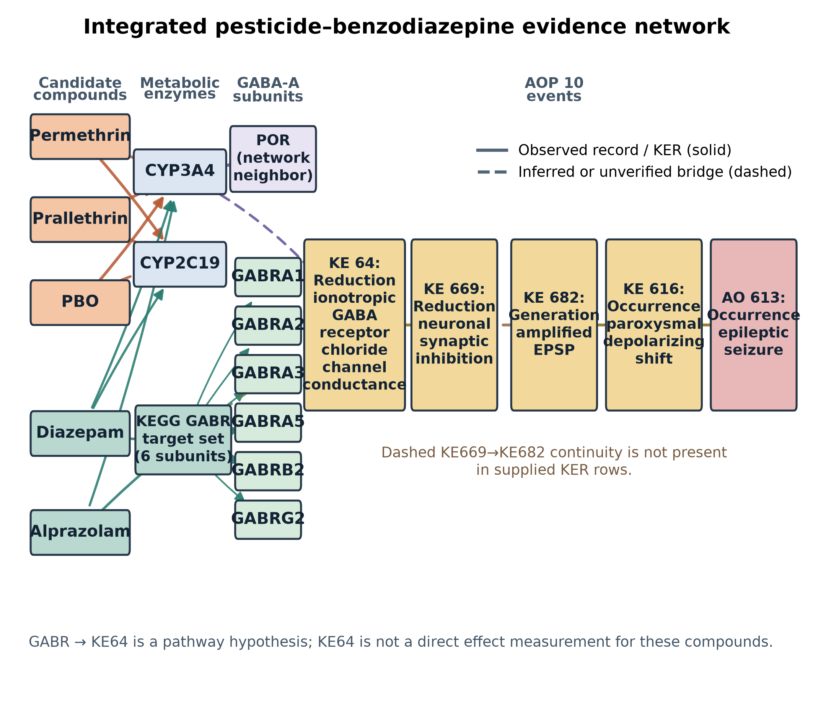
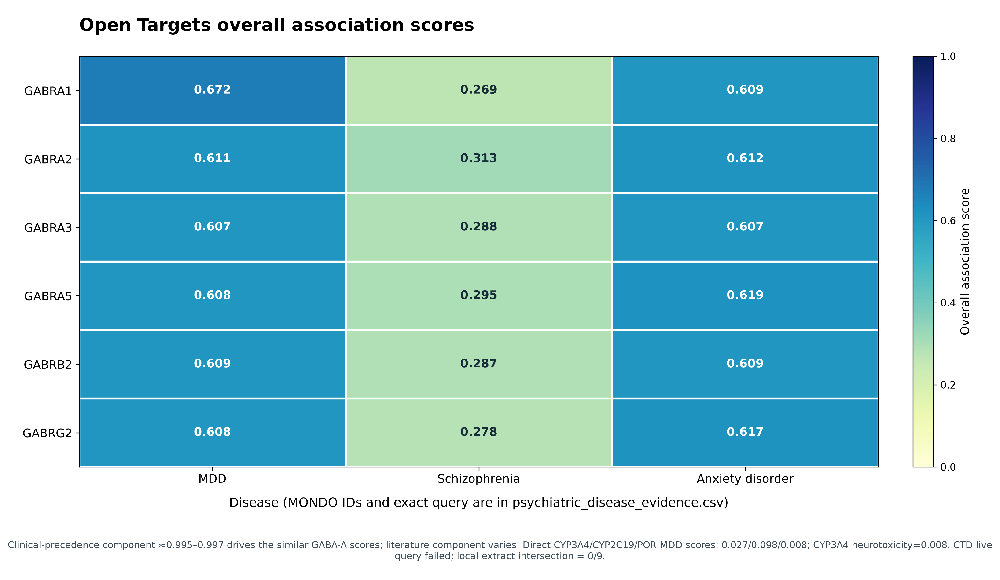
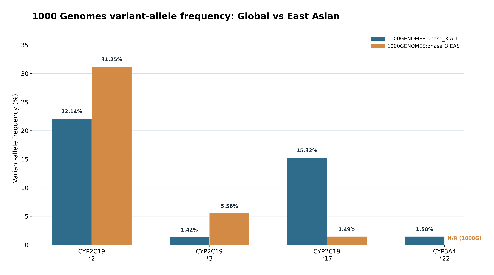

# Evidence-Bounded Integrated Audit of a Candidate Insecticide–Benzodiazepine Combination

**Final report | 27 November 2026**

## 1. Study Scope and Databases

Three insecticides (Permethrin, Prallethrin, piperonyl butoxide / PBO) and two INCB Schedule IV benzodiazepines (Diazepam, Alprazolam) were selected for a shared-metabolism / GABA-A evidence screen because they combine widely used pyrethroid-active or synergist ingredients with two controlled CNS-acting benzodiazepines whose metabolism involves CYP2C19 and CYP3A4. The screening question is whether the retained local records support direct or network-level shared nodes between these five candidates.

**Table 1.** Database coverage and retained record scope. Paths, URLs, and long identifier lists stay with the cited records or References; Table 1 reports scope and count only.

| Database / Source | Evidence Scope | Retained Records | Retrieval / Provenance Date |
|---|---|---|---|
| CTD (chemical–gene) | Permethrin CYP interaction direction; neurotoxicity gene set | Permethrin D026023 → CYP2C19 (1557) and CYP3A4 (1576), PMID 24548679 direction; 33 neurotoxicity-gene rows (MeSH `MESH:D020258`) | Local extract (original query date unrecorded) for the 33-gene file; Permethrin PMID-linked local extract; live CTD recheck attempted 2026-11-27 and failed / no parseable disease-gene result |
| PubChem BioAssay | Prallethrin CYP bioassay activity | 7 unique AIDs for Prallethrin–CYP2C19/CYP3A4 (see `data/pubchem_aids.csv`) | PUG-REST assay-summary check 2026-11-27 (all seven returned one summary record); original AIDs are local extracts with retrieval date “Local extract (original query date unrecorded)” |
| ChEMBL | CYP3A4 activity-record availability for PBO and ingredients | PBO / CHEMBL1201131 × CYP3A4 / CHEMBL340 activity records; ingredient–target availability snapshot | 2026-11-27 (activity API log and UniProt/available-target snapshot); archived PBO JSON mtime 2026-09-09 is an artifact timestamp, not a server retrieval timestamp |
| UniProt | Target protein identifiers for the fixed target set | One UniProt lookup per fixed target in the expanded evidence run | 2026-11-27 |
| Ensembl / 1000 Genomes | Population allele frequencies for CYP2C19 and CYP3A4 variants | CYP2C19 `CYP2C19*2`, `CYP2C19*3`, `CYP2C19*17` and CYP3A4 `CYP3A4*22` phase-3 frequencies; EAS vs Global where returned | 2026-11-27 (Ensembl variation `pops=1` responses; `CYP3A4*22` EAS is N/R (1000G)) |
| Open Targets | Candidate-target psychiatric disease associations; direct CYP/POR disease lookups | 18 observed GABA-A gene–disease pairs across MDD (`MONDO_0002009`), schizophrenia (`MONDO_0005090`), anxiety disorder (`MONDO_0005618`); CYP3A4 802, CYP2C19 536, POR 540 associated-disease records across pages 0 and 1 | 2026-11-27 (GraphQL first 500 associated targets per disease/direct target query) |
| KEGG Drug | Diazepam / Alprazolam metabolism and target annotations | dr:D00293, dr:D00225 TARGET/METABOLISM fields | 2026-11-27 |
| PMID literature | Permethrin metabolism direction anchor | PMID 24548679 | 2026-11-27 |
| STRING | CYP3A4–POR network-neighbor context | CYP3A4–POR combined score 0.979; POR shown only as an inferred shared node | checked 2026-11-06 |
| AOP-Wiki | AOP 10 key events and adjacent key-event relationships | AOP 10; KE 64 (AO 613 pathway), KE 669, KE 682, KE 616, AO 613; KE669→KE682 KER continuity unreported in retained records | checked 2026-11-22 / 2026-11-23 |
| INCB Green List, 36th edition | Controlled-substance schedule confirmation | Alprazolam PA 004; Diazepam PD 006, Schedule IV | checked 2026-11-23 |
| ClinicalTrials.gov | Background PBO trial scope (background only) | 12 PBO-intervention records in local search scope (11 malaria, 1 lice); no psychiatric/neurotoxicity endpoint in that scope | checked 2026-11-06 |
| GEO / PMID 40253403 | GSE208338 MDD candidate-panel and DEG inputs | GSE208338 / GPL5188 metadata present; retained DEG CSV has zero data rows | metadata checked 2026-11-23; DEG recompute inputs absent (expression matrix, sample metadata, DEG script) |

ClinicalTrials.gov is retained only as background: the local PBO search returned malaria- and lice-oriented records, with no psychiatric/neurotoxicity endpoint in that scope. INCB is retained only to confirm that Alprazolam (PA 004) and Diazepam (PD 006) are Schedule IV substances under the verified 36th edition.

## 2. Evidence Integration and Ranked Pair Matrix

**Observed** means a curated database record, a verified bioassay record, or a peer-reviewed literature record with a verified PMID. **Inferred** means analyst synthesis, network-neighbor propagation, or an unverified pathway bridge; inferred nodes are not promoted to observed. Shared-node count is a screening heuristic.

The ranked matrix comes from `experiment/pair_matrix_2x3.csv`, a 3-insecticide × 2-benzodiazepine table. Observed and inferred shared nodes are shown in separate columns, and the CSV’s `observed_rank` and `tie_break_order` fields are preserved. Generating script: `experiment/build_ranked_matrix.py`.

| Rank | Insecticide | Benzodiazepine | Observed shared nodes (count) | Inferred shared nodes (count) | PMID-supported shared nodes | Bioassay-supported shared nodes |
|---|---|---|---|---|---|---|
| Joint Rank 1 / Tied 1 | Permethrin | Diazepam | `CYP2C19`; `CYP3A4` (2) | POR (1) | `CYP2C19`; `CYP3A4` | — |
| Joint Rank 1 / Tied 1 | Prallethrin | Diazepam | `CYP2C19`; `CYP3A4` (2) | POR (1) | — | `CYP2C19`; `CYP3A4` |
| Joint Rank 3 / Tied 3 | Permethrin | Alprazolam | `CYP3A4` (1) | POR (1) | `CYP3A4` | — |
| Joint Rank 3 / Tied 3 | PBO | Alprazolam | `CYP3A4` (1) | POR (1) | — | `CYP3A4` |
| Joint Rank 3 / Tied 3 | PBO | Diazepam | `CYP3A4` (1) | `CYP2C19`; POR (2) | — | `CYP3A4` |
| Joint Rank 3 / Tied 3 | Prallethrin | Alprazolam | `CYP3A4` (1) | POR (1) | — | `CYP3A4` |

**Table 2.** Ranked insecticide–benzodiazepine shared-node matrix from `experiment/pair_matrix_2x3.csv`. Ranks are driven by observed_shared_count desc, then PMID-supported shared nodes desc, then bioassay-supported shared nodes desc; ties are preserved as `Joint Rank 1 / Tied 1` and `Joint Rank 3 / Tied 3`. The ordering preference for PMID support before bioassay support is an analyst-defined tie-break, not an additional observed measurement.

**Permethrin × Diazepam** and **Prallethrin × Diazepam** are both Joint Rank 1 (Tied 1), each with two observed shared nodes: `CYP2C19` and `CYP3A4`. Permethrin × Diazepam carries the PMID-supported pair, because CTD (PMID 24548679) records CYP3A4 and CYP2C19 as increasing Permethrin metabolism, a substrate/metabolism relationship rather than induction or inhibition, and KEGG Drug METABOLISM for Diazepam (dr:D00293) lists both enzymes. Prallethrin × Diazepam carries the bioassay-supported pair from `data/pubchem_aids.csv`; the retained assay species is recorded as Unknown in the source table. The matrix therefore places Permethrin × Diazepam first only under the analyst-defined tie-break that prefers PMID support before bioassay support; this is a display/ordering convention inside the tied group, not an extra observed measurement.

**Hypothesis paragraph (explicitly labeled).** If Permethrin and Prallethrin share CYP2C19 and CYP3A4 substrate routes, concurrent exposure could create metabolic competition and alter clearance of one or both insecticides and of a co-administered benzodiazepine. That framing is an analyst hypothesis built on the retained substrate/metabolism and bioassay records; it is not an established interaction claim. Retained in-vitro assay records, including Prallethrin records with species listed as Unknown, do not establish substrate competition, inhibition, or synergy at relevant human exposure levels.

**Shared-node-count limitation and PBO alternative.** Shared-node count ignores direction (substrate versus inhibitor), so PBO—despite CYP3A4 activity/inhibition assay signals—falls in the tied Joint Rank 3 group rather than above the tied Rank 1 pairs. Mechanistically, PBO × benzodiazepine is an alternative candidate for follow-up because PBO is discussed as a CYP3A4 modulator in the retained ChEMBL activity rows.

The mixed PBO–CYP3A4 calls must be reported as separate retained records, not collapsed into one active claim: the 501.2 nM Potency endpoint has one Active and one Not Active record, and two 3000 nM IC50 records are also retained. These are retained ChEMBL activity records; they support the presence of a recorded enzyme-assay signal for PBO at CYP3A4 but do not establish a single potency value or an in-vivo interaction.

Where POR appears in the matrix, it is an inferred STRING CYP3A4–POR network-neighbor relationship (combined score 0.979), not direct compound–POR evidence, and it should be read as an inferred shared node only.

## 3. Integrated Mechanism and AOP Context

**Figure 1.** Integrated CYP / GABA-A evidence network. Solid links are observed records; dashed links are inferred or unreported bridges. Generated by `experiment/build_evidence_figures.py` from the retained evidence boundary (`experiment/evidence_table.csv`).

Figure 1 keeps observed and inferred relationships visually distinct, and missing data are visibly missing rather than drawn as observed links. The AOP 10 chain is anchored by KE 64 and AO 613 and includes adjacent key events and key-event relationships from `experiment/evidence_table.csv`; the KE669→KE682 continuity is not supported as an observed KER in the retained records and is treated as unreported rather than observed.

## 4. Bonus 1: Psychiatric Disease Association

**Figure 2.** Psychiatric disease evidence overview. Generated by `experiment/build_evidence_figures.py` from `data/psychiatric_disease_evidence.csv`, `data/psychiatric_cyp_check.csv`, and `experiment/gene_overlap_summary.csv`.

The exact-symbol intersection between the 33-gene CTD neurotoxicity local extract (MeSH `MESH:D020258`) and the nine candidate target symbols is **0/9**, per `experiment/gene_overlap_summary.csv`. This is a local-extract intersection, not a live CTD result; the 33-gene set remains `Local extract (original query date unrecorded)`, and the live CTD recheck on 2026-11-27 did not yield a parseable disease-gene result.

Open Targets returned **18 observed GABA-A gene–disease pairs** across MDD (`MONDO_0002009`), schizophrenia (`MONDO_0005090`), and anxiety disorder (`MONDO_0005618`). The six GABA-A targets are GABRA1, GABRA2, GABRA3, GABRA5, GABRB2, and GABRG2. The main pattern is that MDD and anxiety disorder scores cluster near 0.61, while schizophrenia scores are lower; in prose, GABRA1’s comparatively higher MDD score reflects the returned genetic-association / GWAS credible-set component, and the similar MDD/anxiety totals coincide with a shared, near-saturated `clinical_precedence` component (~0.995–0.997). No `known_drug` component appeared in the 18 returned component arrays. The complete score inventory stays in `data/psychiatric_disease_evidence.csv`; the plotted values are not repeated here as bullets.

Direct CYP/POR Open Targets lookups were run separately with disease IDs and names kept distinct, and cited from `data/psychiatric_cyp_check.csv`. Verified examples include CYP3A4 MDD 0.02670, epilepsy 0.02119, and neurotoxicity (`EFO_0011057`) 0.00776; CYP2C19 MDD 0.09820 and epilepsy 0.04821; the 0.00148 CYP2C19 result is **focal impaired awareness seizure** (`HP_0002384`), not the generic seizure row (0.02870). POR MDD is 0.00776 and epilepsy 0.00277; POR also has a broad anxiety record (`MONDO_0011918`, 0.00294), while the exact anxiety-disorder ID (`MONDO_0005618`) was not returned. These are retained Open Targets association records.

The complete direct disease lists contained 802 CYP3A4, 536 CYP2C19, and 540 POR associated-disease records across pages 0 and 1. None of the three complete lists contained exact MeSH `MESH:D020258`; CYP2C19 and POR also had no neurotoxicity-named record in their complete lists. This is reported as no matching Open Targets record in the complete returned lists, not as biological absence.

The GSE208338 DEG audit is a single-input gap: the retained DEG CSV has zero data rows, and the expression matrix, sample metadata, and DEG script are absent, so the DEG overlap cannot be recomputed from this repository.

## 5. Bonus 2: Pharmacogenomic Population Frequencies

**Figure 3.** CYP2C19 and CYP3A4 population allele frequencies from Ensembl / 1000 Genomes phase 3. Generated by `experiment/build_evidence_figures.py` from `data/pgx_cyp2c19_cyp3a4.csv`.

The largest EAS frequency among the retained star alleles is `CYP2C19*2` at 31.25% versus 22.14% Global; `CYP2C19*17` shows the reverse population pattern, higher globally than in EAS; `CYP3A4*22` is 1.50% Global and **N/R (1000G)** for EAS. Each star-allele name is retained in inline code: `CYP2C19*2`, `CYP2C19*3`, `CYP2C19*17`, and `CYP3A4*22`. N/R is reported as missing population coverage, not converted to 0%.

The Global `CYP3A4*22` value is attributed to the retained Ensembl variation API response (`rs35599367`, `pops=1`, retrieval 2026-11-27). The EAS population was not returned for that variant in the retained query. Diazepam metabolism is described only to the extent supported by the retained KEGG Drug record (dr:D00293 METABOLISM lists CYP2C19 and CYP3A4); population frequency differences are descriptive and do not set individual risk.

## 6. Limitations and Process Audit

The four caveats below appear only once in this report, in this section: the ranking is not a clinical interaction prediction; no mixed-exposure empirical data are available and Bliss classification is unavailable; population frequency is not individual risk; Open Targets scores are not causal evidence. Section 2 includes the required hypothesis counterpoint without restating this list.

Coverage gaps and unresolved items are recorded concisely. CTD live recheck failed on 2026-11-27, while its 33-row gene set remains `Local extract (original query date unrecorded)`. The GSE208338 DEG recomputation inputs are absent, so the DEG overlap is not reported from this repository. `CYP3A4*22` EAS is N/R (1000G) in the retained Ensembl query. The CTD neurotoxicity overlap is reported in Section 4 as 0/9 from the local extract; it is not omitted or treated as unreportable. PubChem AID pages required a browser verification challenge during the audit, but the seven unique AIDs were verified through PUG-REST on 2026-11-27 and all returned one assay summary record; the original assay values remain local extracts. Several legacy PNGs do not have matching generator scripts in the current `experiment/` set, so their generation path remains unresolved. The original classroom workbook external publisher/source is not retained, and the original CTD query date is not embedded in the local extract.

## Reproducibility Metadata

| Field | Value |
|---|---|
| Coding environment / agent | OpenCode |
| Model | Solar Pro 4 |
| Report date | 2026-11-27 |
| Ranking script | `experiment/build_ranked_matrix.py` |
| Figure script | `experiment/build_evidence_figures.py` |
| Prompt | Read ONLY skill/evidence-report/SKILL.md, data/SOURCE_PROVENANCE.md, data/ctd_direction_audit.csv, data/psychiatric_disease_evidence.csv, data/psychiatric_cyp_check.csv, data/pgx_cyp2c19_cyp3a4.csv, data/pubchem_aids.csv, experiment/pair_matrix_2x3.csv, and experiment/gene_overlap_summary.csv. Do NOT scan experiment/lihc_tcga_pan_can_atlas_2018/ or run any shell commands. Regenerate report/Final_Report.md strictly following the updated SKILL.md: remove the Section 5 process-history sentence ("previously copied from..."), place the four core caveats ONLY in Section 6 (do not repeat them in Sections 2, 4, or 5), use `data/expanded_db_evidence.csv` in References 5 and 8, and paste THIS EXACT PROMPT VERBATIM into the Reproducibility Metadata Prompt cell without paraphrasing. Do NOT convert to PDF yet. |

## References

1. CTD / PubMed. CYP2C19 and CYP3A4 increase Permethrin metabolism (PMID 24548679). https://pubmed.ncbi.nlm.nih.gov/24548679/; [CTD chemical D026023](https://ctdbase.org/detail.go?type=chem&acc=D026023); [PubMed 24548679](https://pubmed.ncbi.nlm.nih.gov/24548679/). Local: `data/ctd_direction_audit.csv`. Permethrin direction from retained PMID-linked local extract; live CTD recheck attempted 2026-11-27 and failed / no parseable disease-gene result.
2. CTD neurotoxicity gene set. 33 rows, MeSH `MESH:D020258`. https://ctdbase.org/detail.go?type=gene&acc=1557 (CYP2C19); https://ctdbase.org/detail.go?type=gene&acc=1576 (CYP3A4). Local: `data/ctd_neurotoxicity_genes.csv`. Local extract (original query date unrecorded).
3. PubChem BioAssay. Prallethrin bioassay AIDs (7 unique AIDs: 1671197, 2284395, 1671201, 2283680, 2283689, 2283698, 2284096). https://pubchem.ncbi.nlm.nih.gov/docs/bioassays; per-AID locators in `data/pubchem_aids.csv`. PUG-REST assay-summary check 2026-11-27; all seven returned one summary record. Original AIDs are local extracts with retrieval date “Local extract (original query date unrecorded)”.
4. ChEMBL. PBO / CHEMBL1201131 × CYP3A4 / CHEMBL340 activity records. https://www.ebi.ac.uk/chembl/api/data/activity.json?molecule_chembl_id=CHEMBL1201131&target_chembl_id=CHEMBL340. Local: `data/expanded_db_evidence.csv`; `data/chembl_availability_data.json`. Retrieved 2026-11-27; archived PBO JSON mtime 2026-09-09 is an artifact timestamp, not a server retrieval timestamp.
5. UniProt. Fixed-target protein entries used in the expanded evidence run. https://rest.uniprot.org/uniprotkb/. Retrieval 2026-11-27. Local: `data/expanded_db_evidence.csv`.
6. Ensembl / 1000 Genomes phase 3. CYP2C19 rs4244285 (`CYP2C19*2`), rs4986893 (`CYP2C19*3`), rs12248560 (`CYP2C19*17`); CYP3A4 rs35599367 (`CYP3A4*22`). https://rest.ensembl.org/variation/human/rs4244285?pops=1; https://rest.ensembl.org/variation/human/rs4986893?pops=1; https://rest.ensembl.org/variation/human/rs12248560?pops=1; https://rest.ensembl.org/variation/human/rs35599367?pops=1. Retrieval 2026-11-27. Local: `data/pgx_cyp2c19_cyp3a4.csv`. `CYP3A4*22` EAS is N/R (1000G).
7. Open Targets. MDD `MONDO_0002009`; schizophrenia `MONDO_0005090`; anxiety disorder `MONDO_0005618` associated targets; direct CYP3A4 `ENSG00000160868`, CYP2C19 `ENSG00000165841`, POR `ENSG00000127948` associated-disease lookups. https://api.platform.opentargets.org/api/v4/graphql. Retrieval 2026-11-27. Local: `data/psychiatric_disease_evidence.csv`; `data/psychiatric_cyp_check.csv`. Scores are association rankings, not causal evidence.
8. KEGG Drug. Diazepam dr:D00293; Alprazolam dr:D00225. https://rest.kegg.jp/get/dr:D00293; https://rest.kegg.jp/get/dr:D00225. Retrieval 2026-11-27. Local: `data/expanded_db_evidence.csv`.
9. STRING v12.5. CYP3A4–POR combined score 0.979. https://string-db.org/. Checked 2026-11-06. Local: `experiment/evidence_table.csv`. POR shown as an inferred STRING CYP3A4–POR network-neighbor relationship, not direct compound–POR evidence.
10. AOP-Wiki. AOP 10; KE 64; AO 613; adjacent key events and key-event relationships. https://aopwiki.org/aops/10; https://aopwiki.org/events/64; https://aopwiki.org/events/613. Checked 2026-11-22 / 2026-11-23. Local: `experiment/evidence_table.csv`. KE669→KE682 KER continuity is unreported in retained records.
11. INCB. *Green List*, 36th edition (2025), Schedule IV, Alprazolam PA 004; Diazepam PD 006. https://www.incb.org/incb/uploads/documents/Psychotropics/forms/greenlist/2026/2510307E.pdf. Checked 2026-11-23. Local: `experiment/evidence_table.csv`.
12. ClinicalTrials.gov. PBO-intervention study scope (background only). https://clinicaltrials.gov. Checked 2026-11-06. Local: `experiment/clinpgx_clinicaltrials_evidence.txt`.
13. GEO / PMID 40253403. GSE208338, GPL5188, postmortem human DLPFC, MDD n=24, controls n=62. https://www.ncbi.nlm.nih.gov/geo/query/acc.cgi?acc=GSE208338; https://pubmed.ncbi.nlm.nih.gov/40253403/. Checked 2026-11-23. Local DEG file has zero data rows; DEG recompute inputs absent.
